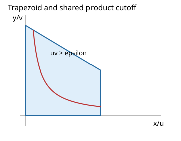

# Shared cutoffs on clipped polygons and graphs

See the [method reference guide](../method-references.md) for the identities, theorem sources,
implementation map and attribution limits behind these methods.

The regulator `|g|>epsilon` specifies one simultaneous cutoff. For `g=c*u*v`, its scale c affects the finite-part constant and must be preserved by every coordinate map. Sequential coordinate finite parts describe a different prescription.



## Geometry and moment proof

The native polygon family consists of bounded convex polygons that are downward closed in each occupied orthant, with the origin in their closure. Certify linear constraints, construct the lower envelope of descending affine upper bounds `v=A*u+B`, and split at all certified line crossings. Within each segment the product cutoff has lower boundary `v=epsilon/(abs(c)*u)`. Its intersections with the upper line are roots of `A*u**2+B*u-epsilon/abs(c)=0`.

A strictly positive cutoff window ensures the roots, segment vertices and envelope order are valid simultaneously. Integrate supported integer Laurent monomials exactly and sum all occupied orthants. Absolute determinants, orthant signs, defining-equation scale and segment coverage are independent prerequisites. Sloping lower constraints, holes, unproved or degenerate windows and arbitrary polygons are outside this native family.

## Executable public example

```{literalinclude} ../../examples/geometry_casebook.py
:start-after: example-start: cutoff
:end-before: example-end: cutoff
:dedent: 4
:language: python
```

Polynomial graph maps such as `v=y-x**2` have determinant one and preserve `x*(y-x**2)` as `u*v`. Their transformed domain can be a supported polygon or a certified disjoint box cover. Affine maps also retain their determinant. Provenance records the original source domain and prescription, transformed cover and cutoff window.

`verify_regularization_result` replays the source prescription and rejects tampered answers or provenance. Replay is valuable but is not independent mathematical verification: independent truncated quadrature and constant-term asymptotics exercise different code and formulas. A verified finite part does not establish ordinary convergence.

Claims: `trapezoid-constant` and `source-replay` → `tests/test_casebook_and_docs.py`; orthants, affine maps, epsilon windows and independent finite-part asymptotics → `tests/test_geometry_casebook_properties.py`.
