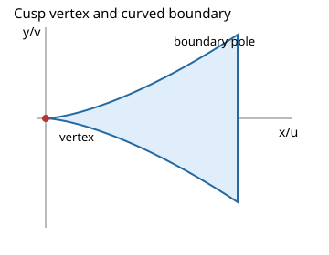

# Cusp vertex, boundary contact and vanishing

See the [method reference guide](../method-references.md) for the identities, theorem sources,
implementation map and attribution limits behind these methods.

Consider `0<x<A, y**2<=k*x**3`, with finite `A>0` and `0<k<=1`, and density `P(x,y)/(x**3-y**2)**s`. The blowup `y=x**(3/2)*t` has Jacobian `x**(3/2)`. For a monomial `x**p*y**q`, its radial exponent is `p+3*q/2+3/2-3*s`.



## Two distinct thresholds

Vertex integrability requires `5/2+p+3*q/2-3*s>0`. If `k<1`, the curved pole is excluded. At contact `k=1`, the angular factor `(1-t**2)**(-s)` also requires `s<1`. Weak inequalities at either threshold are insufficient. A cell including a divergent threshold fiber cannot receive an unconditional absolute-convergence proof.

Exact polynomial division by `x**3-y**2` strips m defining-equation factors from the numerator and replaces s by `s-m`. This proves vanishing identically, rather than inferring it from a sample. At contact, an even monomial contributes `A**h*beta((q+1)/2,1-s)/h`, with `h=5/2+p+3*q/2-3*s`; odd monomials vanish only after their absolute integrability is proved. Definite-sign divergent terms support divergence proofs. A sign-changing expression outside that theorem remains unresolved. Raw polynomial complexity budgets still apply before expensive factor work.

## Executable public example

```{literalinclude} ../../examples/geometry_casebook.py
:start-after: example-start: cusp
:end-before: example-end: cusp
:dedent: 4
:language: python
```

For `s=1/2,p=q=0,A=k=1`, h=1 and the answer is pi. For `x**2/(x**3-y**2)`, the vertex threshold is positive but the curved boundary diverges. These are different mathematical obstructions and the evidence must distinguish them.

Claims: `contact-half-power` → `tests/test_casebook_and_docs.py::test_casebook_public_examples`; `strict-thresholds` and `vanishing` → `tests/test_geometry_casebook_properties.py`; result evidence → `tests/test_serious_boundary_regressions.py`.

Further supported cases and prerequisites are described in [the extension guide](../nonlinear-moments-and-singularities.md). Regression coverage: `tests/test_truncated_nonlinear_horns.py`.
