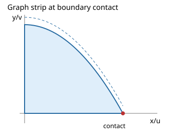

# Parameter geometry over complete cells

See the [method reference guide](../method-references.md) for the identities, theorem sources,
implementation map and attribution limits behind these methods.

A parameter cell is a set of parameter values, not a representative sample. The geometry route must prove every endpoint and bound order throughout that set. For the strip `0<=x<=a, 0<=y<=b-x**2`, the cells `a>0,b>a**2` and `a>0,b=a**2` have areas `a*b-a**3/3` and `2*a**3/3`. Neither formula says what happens in a cell with crossing bounds.



## Interval certificate

Put `x=L+(U-L)*t`, with `0<=t<=1`. A degree-n polynomial has a Bernstein representation `sum(c[j]*binomial(n,j)*t**j*(1-t)**(n-j))`. Nonnegative coefficients certify a nonnegative polynomial on the entire interval. A strictly positive coefficient certifies positivity in its interior. This is a sufficient test: negative coefficients do not prove that the polynomial is negative. Ordering certificates, compactness, real finite coefficients and the selected measure are separate prerequisites.

Exact compact polynomial moments use a termwise route with the configured degree and term budgets applied to the integrated polynomial. Oversized expressions decline unless expensive exact work is enabled.

The native route handles polynomial upper/lower strips with globally ordered envelopes. Crossing envelopes require additional partitioning. A slope that can vanish must be separated into cells before division. Intrinsic dimension and the number of distinct point fibers must remain stable within the cell; split off dimension drops rather than applying a generic-dimensional formula there.

## Executable public example

Imports for all shared examples are listed in the [casebook](../geometry-casebook.md).

```{literalinclude} ../../examples/geometry_casebook.py
:start-after: example-start: parameter
:end-before: example-end: parameter
:dedent: 4
:language: python
```

Inspect `result.cases` and `result.diagnostics['cell_results']` to see each cell's convergence and domain evidence. The parent can be conditional while its parameter-space coverage is complete under its assumptions. Complete coverage does not assert behavior outside those assumptions.

Claims: `parameter-strip-area` → `tests/test_casebook_and_docs.py::test_casebook_public_examples`; `cell-boundary-measure` → `tests/test_serious_boundary_regressions.py::test_intrinsic_dimension_drop_requires_separate_cells`; generated exact oracles and transformations → `tests/test_geometry_casebook_properties.py`.

Further supported cases and prerequisites are described in [the extension guide](../nonlinear-moments-and-singularities.md). Regression coverage: `tests/test_truncated_nonlinear_horns.py`.
